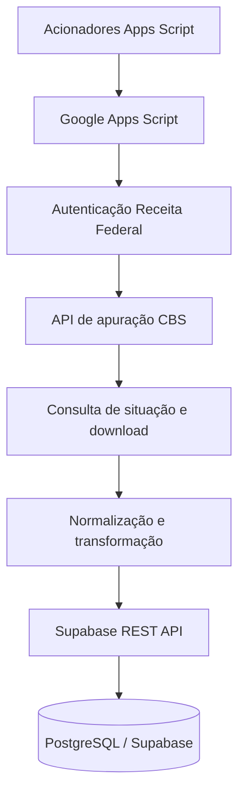
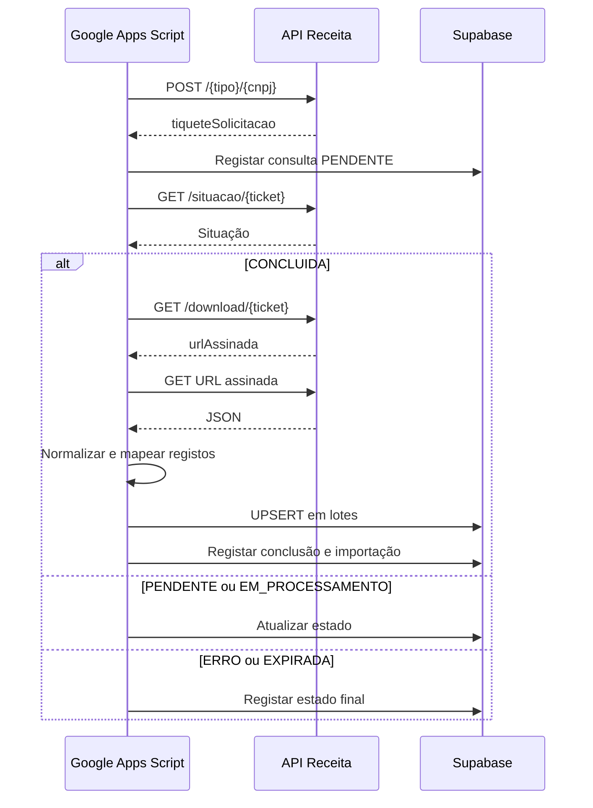
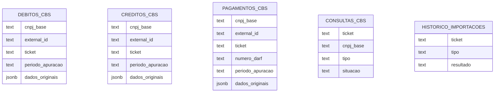

# Arquitetura — Integração CBS Receita Federal + Supabase

## Objetivo
Este documento descreve a arquitetura identificada em `IntegracaoCBS.gs`: uma integração em Google Apps Script que consulta débitos, créditos e pagamentos CBS, acompanha tickets e grava os resultados no Supabase.

> Descrição baseada no código fornecido. Os endpoints, contratos e disponibilidade das APIs não foram validados externamente.

## Visão geral

## Componentes

### Google Apps Script
`IntegracaoCBS.gs` concentra:
- Leitura de configurações nas Script Properties.
- Obtenção e reutilização do token da Receita.
- Abertura de consultas de débitos, créditos e pagamentos.
- Consulta da situação dos tickets e download dos resultados.
- Normalização de datas, períodos e números.
- Geração de identificadores externos.
- UPSERT dos registos em lotes.
- Registo de consultas e importações.
- Instalação e diagnóstico de acionadores.

### API Receita Federal
Endereços declarados no código:
- `https://api.receitafederal.gov.br/apuracao-cbs/v2`
- `https://api.receitafederal.gov.br/token`

Operações construídas:
| Operação | Caminho |
|---|---|
| Abrir consulta | `POST /{tipo}/{cnpj}` |
| Consultar situação | `GET /situacao/{ticket}` |
| Descarregar resultado | `GET /download/{ticket}` |

A autenticação utiliza `client_credentials`, com `CLIENT_ID` e `CLIENT_SECRET`. O token e a expiração são guardados nas Script Properties; a renovação é tentada cinco minutos antes do vencimento.

### Supabase
A persistência usa a REST API `/rest/v1/` e a chave de serviço configurada nas Script Properties.

Tabelas referenciadas:
- `debitos_cbs`
- `creditos_cbs`
- `pagamentos_cbs`
- `consultas_cbs`
- `historico_importacoes`

Alvos de conflito usados no código:
- Débitos, créditos e pagamentos: `cnpj_base,external_id`
- Consultas: `ticket`
- Histórico: `ticket,tipo`

## Fluxo operacional

## Agendamento
`instalarAutomacaoSupabaseCBS()` cria:
| Handler | Frequência configurada |
|---|---|
| `abrirConsultasSupabaseCBS` | Diariamente, na janela das 07:00 |
| `processarConsultasSupabaseCBS` | A cada 15 minutos |

O horário efetivo depende também do fuso horário e das regras de agendamento do Apps Script.

## Configurações e segredos
O código espera as seguintes Script Properties:
| Propriedade | Finalidade |
|---|---|
| `SUPABASE_URL` | URL do projeto Supabase |
| `SUPABASE_SERVICE_ROLE_KEY` | Chave de serviço |
| `CLIENT_ID` | Identificador OAuth |
| `CLIENT_SECRET` | Segredo OAuth |
| `CNPJ_BASE` | Oito algarismos da base do CNPJ |
| `ACCESS_TOKEN` | Token armazenado pelo código |
| `TOKEN_EXPIRA_EM` | Expiração do token em milissegundos |

**Nunca incluir valores reais, chaves, segredos ou tokens no repositório.** A chave `SUPABASE_SERVICE_ROLE_KEY` e o `CLIENT_SECRET` devem permanecer secretos. Repositório privado não substitui boas práticas de gestão de credenciais.

## Modelo lógico de dados identificado

