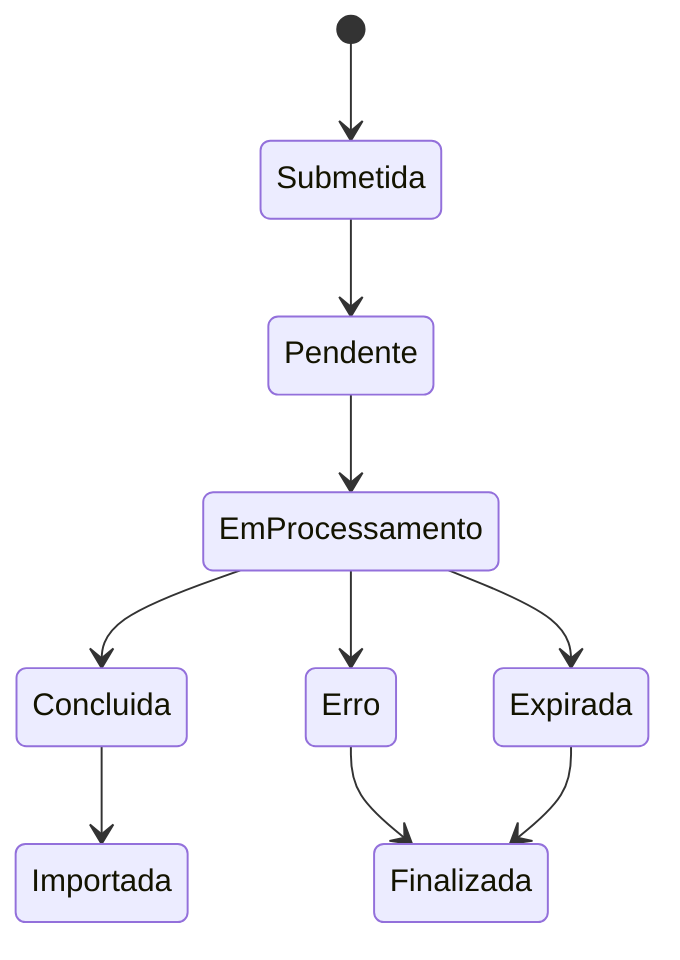

# Fluxo de processamento — Integração CBS

## Tipos processados
- `debitos`
- `creditos`
- `pagamentos`

## Ciclo de vida

O diagrama representa os caminhos tratados pelo código; não é uma lista oficial de estados da API.

## Funções por etapa

| Etapa | Função |
|---|---|
| Abrir os três tipos | `abrirConsultasSupabaseCBS()` |
| Abrir um tipo | `abrirTipoSupabaseCBS(tipo)` |
| Verificar tickets | `processarConsultasSupabaseCBS()` |
| Processar um ticket | `processarTipoSupabaseCBS(tipo)` |
| Descarregar JSON | `baixarParaSupabaseCBS(ticket)` |
| Gravar débitos | `gravarDebitosNoSupabase(json, ticket, cnpj)` |
| Gravar créditos | `gravarCreditosNoSupabase(json, ticket, cnpj)` |
| Gravar pagamentos | `gravarPagamentosNoSupabase(json, ticket, cnpj)` |

## Abertura das consultas
`abrirConsultasSupabaseCBS()` percorre `debitos`, `creditos` e `pagamentos`. `abrirTipoSupabaseCBS(tipo)` valida o tipo e o CNPJ base, evita abrir consultas duplicadas no mesmo dia e não abre outra consulta quando existe ticket anterior ainda não importado ou finalizado.

Para pagamentos existe uma proteção adicional: uma tentativa no dia impede nova tentativa até ao dia seguinte. Se a chamada devolver erro 404, o código regista a ocorrência no log e termina a tentativa.

## Processamento
`processarConsultasSupabaseCBS()` usa `LockService` para evitar execuções simultâneas e processa os três tipos individualmente.

`processarTipoSupabaseCBS(tipo)` consulta a situação do ticket:
- `CONCLUIDA`: descarrega o JSON, grava os registos e atualiza os controlos.
- `ERRO` ou `EXPIRADA`: regista o estado final.
- Outros estados: atualiza a consulta como pendente/em processamento.

## Identificadores e duplicados
Para débitos e créditos, `gerarExternalId(registo)` prefere um identificador fornecido pela Receita. Na ausência dele, calcula SHA-256 com campos documentais.

Para pagamentos, `gerarExternalIdPagamento_(...)` calcula SHA-256 com dados do DARF e da composição.

O UPSERT das tabelas de débitos, créditos e pagamentos utiliza `cnpj_base,external_id` como alvo de conflito.

## Lotes
`CBS_TAMANHO_LOTE` está definido como `300`. `supabaseUpsertLotes` divide os registos em lotes e envia cada lote pela REST API do Supabase.

## Registo e auditoria
- `consultas_cbs`: ticket, CNPJ base, tipo, situação, tempo estimado, mensagem e quantidade de registos.
- `historico_importacoes`: ticket, tipo, quantidade de registos e resultado.

Os campos e constraints definitivos devem ser comparados com o esquema real do Supabase.
